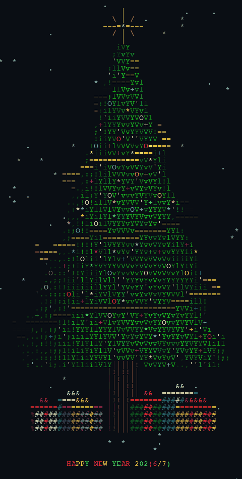

# ASCII Christmas Tree

A rotating 3D Christmas tree drawn with ASCII characters in pygame: a point cloud of
needles, baubles, fairy lights, tinsel and gifts, projected onto a character grid with
a z-buffer and simple lighting, topped with a star and a typewriter greeting.

<p align="center">
  
</p>

## Requirements

- Python 3.9+
- [pygame-ce](https://pyga.me/) and [NumPy](https://numpy.org/)

The project uses `pygame-ce`, the community edition of pygame. It is imported as
`import pygame`, so the code is the same, but it ships ready-made packages for newer
Python versions (including 3.14). Classic `pygame` 2.6.1 has none for Python 3.14, so
pip tries to compile it and fails with `'SDL.h' file not found` unless SDL2 is
installed first.

## Run

```bash
python -m venv .venv
source .venv/bin/activate        # Windows: .venv\Scripts\activate
pip install -r requirements.txt
python main.py
```

The window shrinks automatically if it doesn't fit your screen.

If your environment already has classic `pygame`, remove it first. Both packages install
into the same `pygame` folder and conflict:

```bash
pip uninstall -y pygame
pip install -r requirements.txt
```

## Controls

| Key     | Action                                      |
|---------|---------------------------------------------|
| `Space` | Pause / resume                              |
| `R`     | Restart the animation                       |
| `S`     | Save a screenshot (`christmas_tree_<timestamp>.png`) |
| `Esc`   | Quit                                        |

## Tweaking

- Rotation speed: `angle = t * 0.70` in `main()` (radians per second).
- Greeting text: `MESSAGE` near the top of `main.py`.
